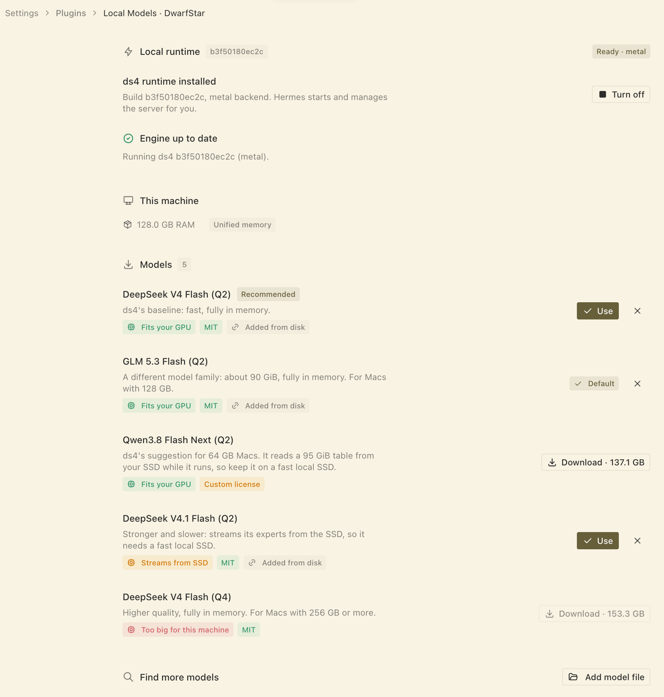
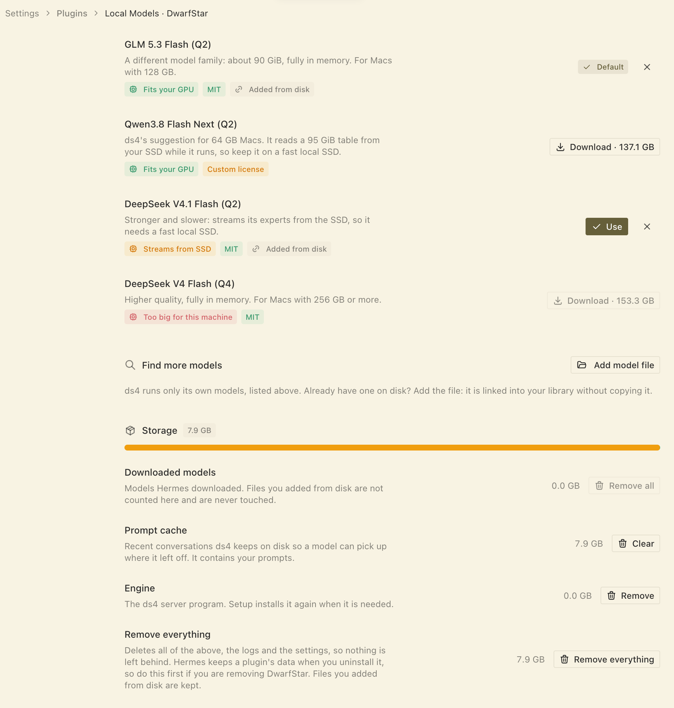

# DwarfStar (ds4) for Hermes

A community plugin that runs [ds4](https://github.com/antirez/ds4) models from
[Hermes Agent](https://github.com/NousResearch/hermes-agent) the way Hermes
runs llama.cpp models: it installs the engine, keeps a library of models,
starts and stops the server, and a model is one click away. No Hermes fork and
no core patches.

**This is an unofficial release.** It is not made, endorsed or supported by
Salvatore Sanfilippo (antirez) or the ds4 / DwarfStar project, by Nous
Research or Hermes Agent, or by DeepSeek. "ds4" and "DwarfStar" are the names
of the engine this plugin drives. It was written with the help of AI coding
agents and checked with tests and by running it against a real ds4-server.

## What you need

- **Hermes Agent 0.23.0 or later.** The settings page needs Hermes Desktop.
- **A Mac with Apple Silicon** for the managed runtime (ds4's Metal backend).
  On any other machine the plugin only attaches to a `ds4-server` you run
  yourself (see below).
- **Memory.** [ds4's hardware guide](https://dwarfstar.sh/hardware/) suggests
  DeepSeek V4 Flash Q2 from 96 GB of memory. It plans about 84 GiB of it.
- **Disk.** About 87 GB free for the default model (the V4.1 model is 366 GB
  and streams from the SSD).

## Install

In Hermes Desktop: Capabilities → Plugins → Install from Git, and paste
`https://github.com/emilianbold/hermes-plugin-ds4`. Or from a terminal:

```sh
hermes plugins install emilianbold/hermes-plugin-ds4
hermes plugins enable ds4
```

Both of the plugin's switches (its Python half and its desktop half) are off
after installing; that is how Hermes treats every plugin. Turn them on in
Capabilities → Plugins, then open **Settings → Plugins → Local Models · DwarfStar** and press
**Set up for me**. Setting up downloads the ds4 engine (about 2 MB), downloads the
model for your memory (about 87 GB), loads it and makes it the default for new
chats. It takes as long as the model download.

From a checkout instead: `ln -s /path/to/hermes-plugin-ds4 ~/.hermes/plugins/ds4`,
then `hermes plugins enable ds4`. Do not copy the folder into
`~/.hermes/desktop-plugins/`: that folder is for desktop-only plugins, and this
one also has a Python half.

**From the terminal.** `hermes model` lists DwarfStar (ds4) and uses the model
the settings page set up; the terminal cannot install the engine or download a
model. If it asks for an API key, any value works: ds4-server has no
authentication.

## What you get

**A settings page**, Settings → Plugins → Local Models · DwarfStar, built to match Settings →
Providers → Local Models (same rows, wording, icons, pills and toasts):

- **Set up for me**: a full-pane setup with a stage rail (Engine, Model,
  Finish), with Pause and Resume.
- **Local runtime**: install the runtime, turn the server on and off.
- **Models**: ds4's own GGUFs, with a fit pill, **Use**, an unload button that
  frees the memory (the next message loads it again), remove, and downloads
  with speed, time left, pause, resume and discard.
- **Find more models**: ds4 runs only its own models, so there is no search;
  **Add model file** opens the native file dialog and links a `.gguf` you
  already have, without copying it. **Forget** removes only the link.
- **Storage**: what DwarfStar keeps on disk, as a bar and a row per kind
  (downloaded models, the prompt cache, the engine) with its size and a button
  to clear it, plus **Remove everything**. Do that before you uninstall the
  plugin: Hermes keeps a plugin's data when you remove it, so the models and
  the prompt cache would otherwise stay on your disk. Files you added from
  disk are never deleted.





**A provider**, `ds4` ("DwarfStar (ds4)" in the model picker):

- Models and the context window come from the running server.
- The server starts with your first message, stops after 15 minutes without a
  request from Hermes (the same idle timeout Hermes uses for llama.cpp) and
  when Hermes exits. It holds the whole model in memory, so it does not run
  when nothing uses it.
- Reasoning effort goes out in the form ds4-server parses.
- Conversation history is replayed so that ds4-server can reuse its live KV
  state from turn to turn instead of reading the conversation again.

## Using a ds4-server you run yourself

Leave the runtime off. Start `ds4-server` with `--ctx 64000` or more and
choose DwarfStar (ds4) in `hermes model`. `DS4_BASE_URL` names a server that
is not at `http://127.0.0.1:8000`; `DS4_API_KEY` is sent as a bearer token for
a proxy in front of it (ds4-server itself has no authentication).

## Third-party software and models

Nothing below is included in this repository. The plugin fetches it when you
ask, and each part stays under its own licence.

| What | From | Licence | How |
|---|---|---|---|
| ds4 engine | [github.com/antirez/ds4](https://github.com/antirez/ds4), at one pinned commit | MIT (with small BSD-3 and MIT parts) | A small archive (about 2 MB) that this repository's GitHub workflow built from that commit, checked against the SHA-256 in `catalog.json`; the licences of everything compiled into it travel inside (`LICENSE`, `NOTICE`, `licenses/`, `third_party/`). ds4 itself publishes no binaries; nothing is compiled on your Mac. |
| DeepSeek V4 Flash (Q2, Q4) | Hugging Face, [antirez/deepseek-v4-gguf](https://huggingface.co/antirez/deepseek-v4-gguf) | MIT (model card) | DeepSeek's model, quantised by antirez. Downloaded at a pinned revision, checked against the SHA-256 in `catalog.json`. |
| DeepSeek V4.1 Flash (Q2) | Hugging Face, [antirez/deepseek-v4.1-flash-gguf](https://huggingface.co/antirez/deepseek-v4.1-flash-gguf) | MIT (model card) | As above. |
| GLM 5.3 Flash (Q2) | Hugging Face, [antirez/glm-5.3-flash-gguf](https://huggingface.co/antirez/glm-5.3-flash-gguf) | MIT (the original model, [zai-org/GLM-5.3-Flash](https://huggingface.co/zai-org/GLM-5.3-Flash); the quantised repository has no card of its own) | Z.ai's model, quantised by antirez. As above. |
| Qwen3.8 Flash Next (Q2) | Hugging Face, [antirez/qwen3.8-flash-next-gguf](https://huggingface.co/antirez/qwen3.8-flash-next-gguf) | **Qwen Community License 1.0, not MIT** (model card and the repository's `LICENSE`) | Qwen's model, quantised by antirez. As above. The licence is MIT-like with two conditions: products with over 100 million monthly users or US$20 million monthly revenue must display the model name, and a business that offers model access as a service or an AI coding or office assistant needs a separate licence from Qwen (your own use is not affected). Read it before commercial use. |

The licences are what the model cards state. The settings page tags every model
with its licence before you download it: MIT in green, and "Custom license" in amber
where the terms go beyond MIT (hover for a note; the full text is in the model's Hugging Face repository, named when you hover its name). Read
them before you redistribute anything. A `.gguf` you add yourself is yours and is never copied or deleted.
[NOTICE](NOTICE) carries the notice for the Hermes Agent wording this plugin
reuses.

## What it does on your machine

- **Engine.** Downloads the engine archive listed in `catalog.json`: a build of
  ds4 made by this repository's workflow (`.github/workflows/engine.yml`) from
  the pinned commit, published as a release here. It checks the archive's size
  and SHA-256, unpacks it and runs it once. Each archive also has a GitHub
  build attestation: `gh attestation verify <archive> --repo
  emilianbold/hermes-plugin-ds4` shows which workflow run built it. If the
  download fails or does not check out, nothing is installed and setup says
  so; the engine is never built on your Mac. Nothing is installed until you ask.
- **Models.** Downloads the files you choose, resuming and retrying if the
  connection drops, and publishes a file only when its size and SHA-256 match
  `catalog.json`.
- **Server.** Runs `ds4-server` on a fixed loopback port per profile with a
  disk KV cache of up to 8 GiB. It is started with a short environment (`PATH`,
  `HOME`, the locale, and ds4's own `DS4_*` tuning variables), not Hermes' own,
  so it never sees your provider keys. Each catalog model starts with its own recipe
  (context and flags such as `--ssd-streaming`); a file you added starts with
  `--ctx 100000`. ds4-server has no authentication, so any program on this Mac
  can use that port, unlike the llama.cpp and oMLX servers, which Hermes starts
  with a random key.
- **Files.** Everything is under the profile's `plugin-data/ds4/`: `engine/`,
  `models/`, `kv/`, `server.log`, `engine-build.log`. A linked model file is
  never moved or deleted.
- **Hermes config.** **Use** and **Set up for me** set the profile's default
  model, as the built-in Local Models page does, and store
  `DS4_API_KEY=dsv4-local` in the profile's `.env`. That value is not a secret:
  ds4-server ignores it. It is a precaution: Hermes' model picker can show a
  provider with no key set as "missing usable credentials". In a fresh profile
  we saw it list ds4 as ready without one, so the key may be unnecessary.
- **Privacy.** No telemetry and no accounts. Once a model is running, chats go
  only to the ds4-server on this Mac. As far as we read its source,
  ds4-server fetches nothing itself (ds4's web access lives in its separate
  agent, which this plugin does not run). ds4 keeps recent prompts in its disk
  cache (`plugin-data/ds4/kv/`) and a log (`server.log`): delete them whenever
  you like.

## Limits

- The managed runtime is macOS on Apple Silicon only.
- The list is ds4's own, short, and the suggestion follows ds4's hardware
  guide: Qwen3.8 Flash Next Q2 for 64 to 95 GB Macs, DeepSeek V4 Flash Q2 for
  96 to 255 GB, V4 Flash Q4 from 256 GB. V4.1 Flash Q2 (streams its experts
  from the SSD) and GLM 5.3 Flash Q2 (about 94 GiB planned, so a 128 GB Mac)
  are offered but never suggested. V4 Flash Q2, V4.1 and GLM were measured on a
  128 GB Mac; V4 Flash Q4 and Qwen3.8 were not, and rely on ds4's own guidance
  and on your feedback. The Qwen entry starts with a 64K context, the least
  Hermes accepts, because it is meant for 64 GB Macs. A `.gguf` you add
  yourself is never blocked, and is recognised by its size.
- "Fits this Mac" compares ds4's own memory plan with this Mac's memory, not the
  file size: V4.1 Q2 is a 341 GiB file that plans about 93 GiB.
- The settings page is under Settings → Plugins, not inside the built-in
  Local Models page: that page is compiled into the app and has no plugin
  seam.
- One model is loaded at a time; choosing another with **Use** restarts the
  server.
- Requests from other programs to the server's port do not count towards the
  idle timeout, so they can find it unloaded. **Turn off** frees the memory
  and keeps it free.
- Images: ds4-server takes them only when started with a vision encoder,
  which the managed runtime does not do yet.
- The provider's client is a live SDK object, so the plugin runs in-process
  (`plugins.isolation: host` is not supported).

## Use at your own risk

This software downloads and runs large files, uses most of your Mac's memory
while a model is loaded, and starts a local server without authentication. It
is provided as is, without warranty, as the [MIT licence](LICENSE) says.


## Acknowledgements

ds4 is by Salvatore Sanfilippo and contributors; the models are DeepSeek's,
quantised by antirez. The settings page and its job handling follow the shape of
[hermes-plugin-omlx](https://github.com/vitaliy-blprnt/hermes-plugin-omlx)
(MIT), and its wording and layout follow Hermes Desktop's Local Models page.

## License

MIT, see [LICENSE](LICENSE). Third-party notices are in [NOTICE](NOTICE).
